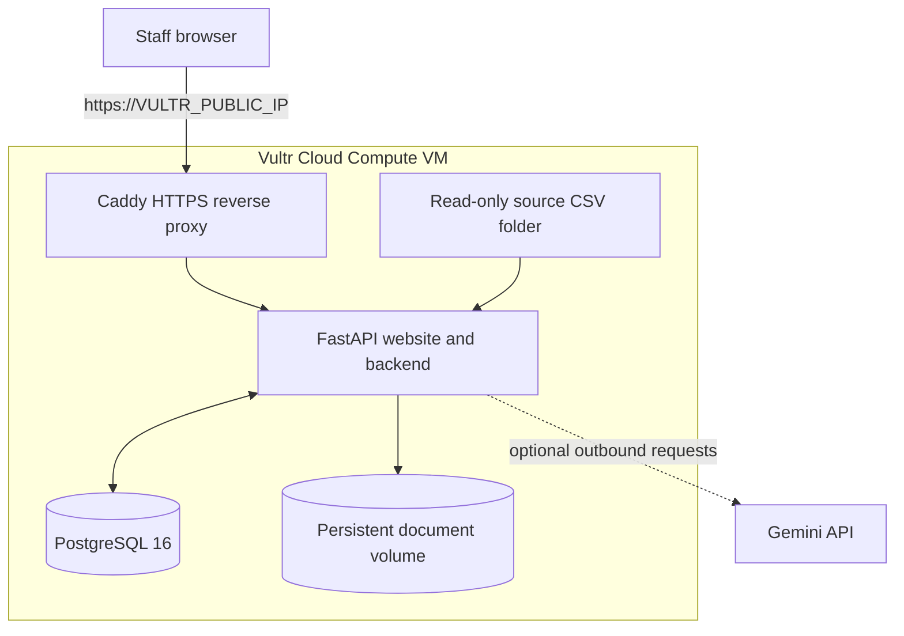

# Wai Intelligence

Wai Intelligence is business intelligence tool for WaterAid Canada. It has five key areas: funding prospecting, reporting intelligence, donor stewardship, ethical partnership due diligence, and proposal/grant compliance.

## Architecture

- **Caddy:** public HTTPS entry point, IP-address certificate management and response security headers.
- **FastAPI:** server-rendered HTML pages, authentication, role checks, request validation and workflow actions.
- **PostgreSQL 16:** persistent application records on the private Docker network.
- **Source CSV folder:** read-only mount. Production files are kept outside the Git checkout, at `/opt/wai-data/source` on Vultr.
- **Document volume:** persistent uploads for grant/proposal documents.
- **Gemini:** optional outbound LLM service for selected tasks; a Gemini API key is not required to start the website.



## Source datasets

The expected source files are:

- `constituent_profile_table.csv`
- `gift_transactions_table.csv`
- `CRM_interacions_table.csv` — the filename spelling is preserved from the supplied brief.
- `video_email_data_table.csv`

## Database and persistence

PostgreSQL is the supported runtime database. Docker Compose provisions PostgreSQL 16 with a persistent volume. The database is private to the Docker network. Uploaded grant documents use a separate persistent Docker volume. Production source CSVs remain external files.

PostgreSQL stores application-managed records such as users, roles, funding leads, reporting metrics, demonstration stewardship examples, due-diligence cases, evidence, tasks, grant-document metadata and obligations. It does not store the raw source CSV rows.

## Local setup

Requirements: Python 3.12+, Docker Engine and Docker Compose plugin.

1. Copy `.env.example` to `.env`. Its default values are for local development only.
2. Start PostgreSQL:

   ```bash
   docker compose up -d db
   ```

3. Create and activate a Python environment, then install dependencies:

   ```bash
   python -m venv .venv
   source .venv/bin/activate       # Windows: .venv\Scripts\activate
   pip install -r requirements.txt
   ```

4. Start the web application:

   ```bash
   uvicorn app.main:app --reload
   ```

5. Open `http://127.0.0.1:8000`.

Local demonstration accounts are `admin` / `WaiAdmin!2026` and `fundraiser` / `WaiUser!2026`. They are for local evaluation only and must not be used for a public deployment. Production setup must set `DEMO_SEED_USERS=false` and `DEMO_SEED_DATA=false`, then create real users with the `app.scripts.create_user` command described in the Vultr guide.

## Verification

Start the local PostgreSQL service, then run:

```bash
docker compose up -d db
python -m pytest -q
```

The application supports Canadian English and Canadian French. It is engineered toward WCAG 2.2 AA; automated tests do not constitute formal accessibility certification. Complete keyboard, screen-reader, zoom/reflow and browser checks before production acceptance.
