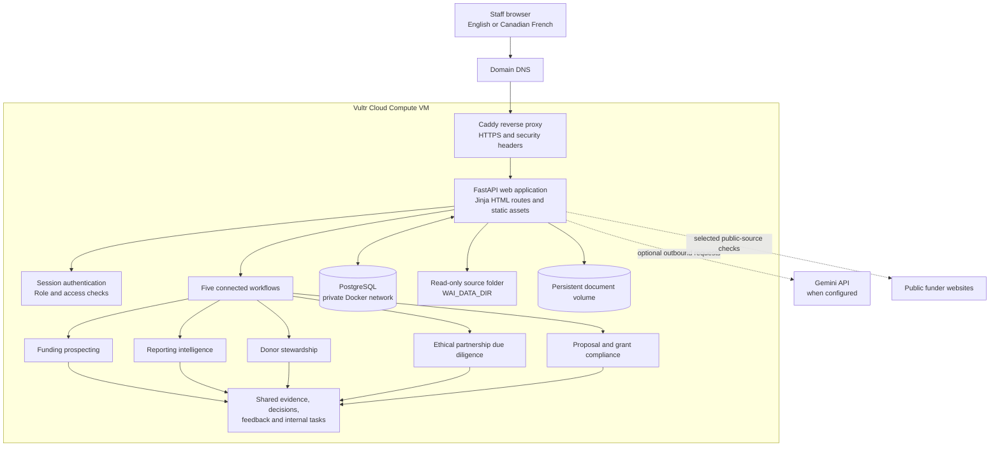

# Wai Intelligence

Wai Intelligence is a server-rendered FastAPI decision-support workspace for WaterAid Canada. It brings five related workflows into one authenticated application. It is designed for a small team that needs to identify opportunities, understand performance, steward donor relationships, document partnership risk and manage grant obligations without splitting work across disconnected tools.

## Quick links

- **[Step-by-step Vultr VM deployment guide](docs/VULTR_DEPLOYMENT.md)**
- [Architecture and workflow boundaries](docs/ARCHITECTURE.md)
- [Source data dictionary](docs/DATA_DICTIONARY.md)
- [Accessibility audit](docs/ACCESSIBILITY_AUDIT.md)
- [Operating cost model](docs/OPERATING_COST_MODEL.md)

## Architecture

The browser uses ordinary HTML routes and form submissions. FastAPI serves the web pages, static assets and workflow actions; there is no separately hosted frontend and no API-based client-side routing. Caddy is the public web entry point and provides HTTPS. PostgreSQL stores application records. Source CSVs remain files and are mounted read-only into the application container.



### Use cases

| Workflow | What it supports | Decision owner |
|---|---|---|
| Funding prospecting | Monitor selected Canadian funders, assess WASH and international-development fit, summarize eligibility and deadlines, identify uncertainties and prepare a first-contact brief. | Fundraising staff decide whether to pursue. |
| Reporting intelligence | Compare periods, check definitions and data quality, flag trends/anomalies and prepare board, leadership or staff narratives with evidence links. | Staff verify the analysis and approve the report. |
| Donor stewardship | Review source-backed constituent profile and activity data; use separate fictional records to demonstrate preference-aware draft communications. | Fundraisers approve any detail, task or communication. Nothing is sent automatically. |
| Ethical partnership due diligence | Organize public evidence against review criteria, label uncertainty and identify questions or escalation needs. | Authorized staff make the Go/No-Go decision. Demo criteria remain assumptions until the approved WaterAid framework is provided. |
| Proposal and grant compliance | Review proposals and grant documents, extract candidate obligations, connect clauses to dates and versions, and flag gaps or delivery bottlenecks. | Programme and grant staff verify each interpretation and obligation. |

The workflows share an evidence register, review decisions, feedback and an internal task list. This is the interoperability layer: for example, a funding lead can create a verification task, and a grant-document finding can be assigned and tracked without moving it into another task platform.

## Source datasets

Place the approved CSV files in `data/source/` or set `WAI_DATA_DIR` to another directory readable by the application. Docker mounts that directory read-only. The application reads source rows in place and does not insert them into PostgreSQL, modify the original files or create donor records from them.

The four expected files are:

- `constituent_profile_table.csv`
- `gift_transactions_table.csv`
- `CRM_interacions_table.csv` — filename spelling is preserved from the supplied brief.
- `video_email_data_table.csv`

The Constituent Source Data view is available from Donor Stewardship. It reads the profile table and performs an in-memory match on the exact `CONSTITUENT_ID` against the transaction, CRM interaction and email/video files. The view shows the counts of matching rows in those files; these counts are not represented as lifetime totals. Nothing from the join is persisted to PostgreSQL. Constituent and contact identifiers are treated as strings.

`LIFETIME_GIVING` is displayed exactly as provided because the source snippet does not specify a currency. `CAPACITY_ESTIMATE` is displayed as a source-provided field, not independently inferred or validated. Blank fields remain blank in the source and appear as “Not provided” in the interface.

**Dataset completeness:** the ZIP package includes the three rows shown in the constituent-profile snippet and the sample rows from the earlier brief. It does not contain the full production exports. Replace those samples with the approved complete datasets before a pilot. Keep production constituent data on private, access-controlled storage and do not commit it to a public Git repository.

The authenticated Data Exports page provides individual CSV downloads and a ZIP bundle. Source-file exports retain the original file names and columns. Workspace-record exports are separate from the source files.

## Database choice and persistence

The earlier scaffold created `data/wai_intelligence.db` because its local development default was SQLite. It contained seeded demonstration records and was included in the previous ZIP by mistake, despite the Vultr Docker Compose design already provisioning PostgreSQL. That mismatch is corrected here. This package does not migrate any changes made in an older SQLite copy; export any records you intentionally added to that old local demo before discarding it.

**The application runtime now defaults to PostgreSQL.** The Vultr and Docker Compose deployment uses the PostgreSQL 16 service and a persistent `postgres_data` volume. The database is on the private Compose network; it is not exposed to the public internet. The old `.db` file has been removed from this package, and database artifacts are ignored by Git. Uploaded grant documents use a separate persistent Docker volume. Source CSVs remain outside the database.

PostgreSQL stores application-managed records such as users, roles, funding leads, reporting metrics, fictional stewardship examples, due-diligence cases, evidence, tasks, grant-document metadata and obligations. It does not store the raw source CSV rows.

## Local setup

Requirements: Python 3.12+, Docker Engine and Docker Compose plugin. PostgreSQL is used locally and on Vultr.

1. Copy `.env.example` to `.env`. For a local demonstration, its development-only values are sufficient. Do not reuse them in a public deployment.
2. Start the PostgreSQL service:

   ```bash
   docker compose up -d db
   ```

3. Create and activate a Python environment, then install dependencies:

   ```bash
   python -m venv .venv
   source .venv/bin/activate       # Windows: .venv\Scripts\activate
   pip install -r requirements.txt
   ```

4. Start the web application:

   ```bash
   uvicorn app.main:app --reload
   ```

5. Open `http://127.0.0.1:8000`. The local database connection in `.env.example` targets PostgreSQL on `localhost:5432`.

The local demo accounts are `admin` / `WaiAdmin!2026` and `fundraiser` / `WaiUser!2026`. They are for local evaluation only. Do not use them for a public deployment. For a clean Vultr deployment, set both `DEMO_SEED_USERS=false` and `DEMO_SEED_DATA=false`. The app still initializes its standard public-source definitions and default fit criteria, but it does not create demo users or fictional workflow records in a new database. Existing records are not deleted when these settings are changed.

## Vultr deployment

Follow the **[Step-by-step Vultr VM Deployment Guide](docs/VULTR_DEPLOYMENT.md)** from top to bottom. It identifies whether each command runs on your computer or inside the VM and provides the exact console selections, DNS and firewall rules, Docker installation commands, ZIP and CSV transfer commands, production environment settings, service startup, user creation, verification, backups and update procedure.

The production topology is one Vultr Cloud Compute VM running Caddy, the FastAPI web application and PostgreSQL 16 with Docker Compose. Caddy publishes HTTPS; FastAPI and PostgreSQL remain on a private Docker network. No separate frontend hosting service is required.

## Verification

Run the test suite against PostgreSQL. Start the local PostgreSQL service first, then run pytest:

```bash
docker compose up -d db
python -m pytest -q
```

The GitHub Actions workflow also provisions PostgreSQL 16 for the test job.

## Documentation

- [`docs/DATA_DICTIONARY.md`](docs/DATA_DICTIONARY.md) — source CSV schemas, field meanings and read-only handling.
- [`docs/ARCHITECTURE.md`](docs/ARCHITECTURE.md) — workflow boundaries, shared records and security model.
- [`docs/ACCESSIBILITY_AUDIT.md`](docs/ACCESSIBILITY_AUDIT.md) — WCAG 2.2 AA target, automated checks and required manual verification.
- [`docs/OPERATING_COST_MODEL.md`](docs/OPERATING_COST_MODEL.md) — demonstration operating-cost assumptions.

The interface supports Canadian English and Canadian French. It is engineered toward WCAG 2.2 AA; automated tests do not constitute a formal accessibility conformance certification. Complete the manual keyboard, screen-reader, zoom/reflow and browser checks in the accessibility audit before production acceptance.
