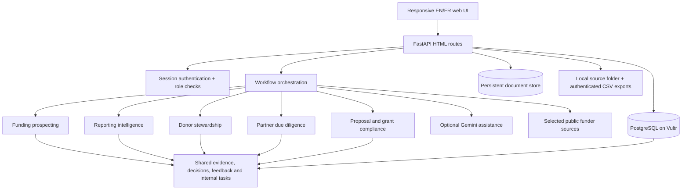

# Wai Intelligence — architecture

## Design

Wai Intelligence is a server-rendered FastAPI web application. Browser navigation uses HTML routes and form submissions; OpenAPI, Swagger and ReDoc endpoints are disabled. `base.html` is the shared layout. Workspace navigation is rendered only for authenticated workspace pages, never on the public landing page.

## Shared intelligence objects

- **Evidence**: source or calculation, source date, URL/reference, classification, confidence and caveat.
- **Decision**: human decisions and review notes stored as evidence entries.
- **Task**: internal follow-up action with owning workflow and optional linked record.
- **Feedback**: reviewer rating and comment on an output.
- **Sources**: selected public source URLs, configured review frequency, last check status and page-change hash.
- **Network relationships**: person/organization/funder links with source, confidence and verification status.

The modules are interoperable through these shared objects. A prospect can create a verification task; a reviewed relationship can inform fundraising staff; a grant obligation can generate an internal task; report drafts and due-diligence findings are preserved in the same evidence register.

## Workflow boundaries

| Workflow | LLM support | Deterministic / human work |
|---|---|---|
| Funding prospecting | Optional interpretation of changed public-source text | Source polling, timestamps, fit score, probability heuristic/N/A gates, eligibility verification and pursuit decision |
| Reporting | Audience-specific narrative draft | Period comparisons, metrics, definitions and anomaly labelling |
| Stewardship | Draft preparation from approved synthetic/local donor records | Preference checks, restriction enforcement, approval and internal follow-up |
| Due diligence | Optional research synthesis | Evidence classification, source entry, coverage gaps and final go/no-go decision |
| Proposal / grant compliance | Proposal critique and candidate-obligation extraction | Document versioning, clause verification, agreement interpretation and completion status |

There are no CRM, Outlook, Asana, email-sending, calendar-sync or third-party task integrations. Follow-up work is managed internally in Wai Intelligence. No external communications, proposal submissions or partner approvals are sent automatically.

## Data, exports and security

- `WAI_DATA_DIR` is configurable; the three user-supplied CSVs are mounted read-only in Docker.
- `read_source_records()` reads allow-listed CSVs directly from that folder and keeps identifier fields as strings. It does not insert source rows into SQLAlchemy models or copy them into donor profiles.
- Startup and the dashboard perform a read-only source-folder scan for file names, headers and row counts. Source rows are only read by a workflow/export that explicitly requests them.
- Synthetic stewardship profiles and synthetic reporting metrics are independently seeded demo records. They are not created from, matched to, or enriched by the source CSVs.
- Constituent/contact identifiers are retained as strings exactly as supplied in the sample source files.
- Original source files are not modified by the loader. CSV exports are re-serialized with spreadsheet-formula protection.
- Authenticated exports are available per dataset or as a ZIP. Grant-document exports contain metadata only and exclude extracted text and filesystem paths.
- PostgreSQL persists operational records. Uploaded documents persist in a named Docker volume.
- Passwords are PBKDF2-SHA256 hashed; sessions are signed and role-checked on every workspace route; mutating forms require CSRF tokens.
- The administrator can grant/revoke the staff account. A revoked account is rejected on its next request. The active administrator cannot revoke their own account.
- The due-diligence case set is fictional. Its criteria are explicitly assumptions until the approved WaterAid policy is loaded.
