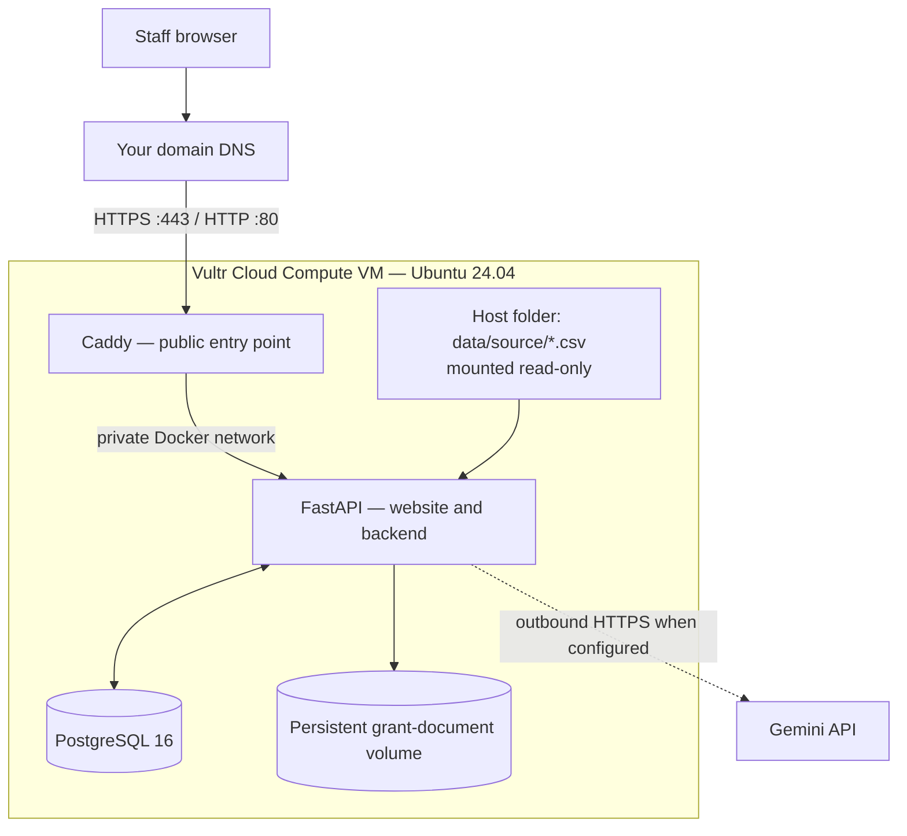

# Wai Intelligence: step-by-step Vultr deployment

This runbook deploys the Wai Intelligence website and FastAPI backend to **one Vultr Cloud Compute VM**. Follow the steps in order. Each command is labelled to show whether it belongs on your own computer or inside the VM.

The deployment uses:

- Ubuntu 24.04 LTS on Vultr Cloud Compute.
- Docker Compose to run the application services.
- FastAPI to serve both the website and its backend workflows.
- PostgreSQL 16 for application-managed records.
- Caddy for the public website, HTTPS certificates and reverse proxy.
- The four supplied CSV datasets in a host folder mounted read-only into the app container.

There is no separate Vercel frontend and no separate frontend hosting account.

---

## At a glance: what you will do

1. Create a Vultr VM and firewall rules.
2. Point a domain name at the VM.
3. Connect to the VM and install Docker.
4. Copy the Wai Intelligence project ZIP to the VM.
5. Copy the four complete CSV files to the VM.
6. Set production passwords, domain and Gemini key.
7. Start FastAPI, PostgreSQL and Caddy.
8. Create real administrator and staff accounts.
9. Open the HTTPS website and test it.
10. Configure backups and learn how to deploy updates.

**Estimated operator effort:** allow 60–120 minutes for a first deployment, excluding DNS propagation and any account or domain setup delays. This is a planning estimate, not a guaranteed duration.

## Before you start

Have these items ready:

- A Vultr account with billing enabled.
- A domain name you control, for example `example.org`.
- The application archive: `wai-intelligence-vultr-step-by-step.zip`.
- The complete approved versions of these four CSV files:
  - `constituent_profile_table.csv`
  - `gift_transactions_table.csv`
  - `CRM_interacions_table.csv` (the spelling is intentionally preserved from the supplied specification)
  - `video_email_data_table.csv`
- A Gemini API key if you want the Gemini-powered functions enabled. The rest of the app can be deployed without it, but AI-assisted functions will not have live Gemini access.
- A computer with Terminal (macOS/Linux) or PowerShell (Windows). The `ssh` and `scp` commands are available in current macOS, Linux and Windows installations.

**Important about the CSV files:** the ZIP contains only the sample rows previously supplied for the challenge. Copy the complete approved CSV files from your secure location in Step 8. Do not place real constituent data in a public Git repository or a public application archive.

## The deployment layout



Only Caddy is exposed to the public internet. FastAPI and PostgreSQL communicate over a private Docker network. The CSV folder is mounted read-only; the app reads the source rows in place and does not import them into PostgreSQL.

---

## Step 1 — Create the Vultr VM

Do these actions in the **Vultr control panel**.

1. Sign in to [Vultr](https://my.vultr.com/).
2. Open **Products → Compute** and choose **Deploy Instance** (the exact button label may vary slightly as the control panel changes).
3. Select **Cloud Compute**. For a small-team pilot, choose a Shared CPU plan with at least **2 vCPUs and 4 GB RAM** as a starting point. Monitor resource use after launch and resize if needed.
4. Choose a region approved by your organization for its data-residency and operational requirements.
5. Under the operating system/image selection, choose **Ubuntu 24.04 LTS, 64-bit**.
6. Under SSH keys, add your computer's public SSH key and select it for this instance. Prefer SSH-key access over password-only root access.
   - If you do not already have an SSH key, create one on your computer with `ssh-keygen -t ed25519` and follow the prompts. Add the contents of the generated `.pub` file to Vultr.
7. Give the instance a hostname such as `wai-intelligence`.
8. Select the firewall group after you create it in Step 2, or return to attach it after the VM is created.
9. Deploy the instance.
10. When Vultr shows the instance as active, copy its **public IPv4 address**. In the commands below, replace `VM_PUBLIC_IP` with that address.

The 2-vCPU/4-GB recommendation is an initial sizing suggestion for a small pilot, not a measured capacity guarantee. If the app will process many large grant documents or several staff members will use it concurrently, monitor RAM, CPU and disk and resize accordingly.

Vultr reference: [Cloud Compute documentation](https://docs.vultr.com/products/compute/instances/cloud-compute).

## Step 2 — Create and attach the Vultr firewall

Do this in the **Vultr control panel**.

1. Open **Products → Network → Firewall**.
2. Create a firewall group named `wai-intelligence-firewall`.
3. Add these **inbound** rules:

| Protocol | Port | Source | Why it is needed |
|---|---:|---|---|
| TCP | 22 | Your current public IP only (for example `203.0.113.10/32`) | SSH administration |
| TCP | 80 | Any IPv4 and IPv6 address | HTTP redirect and HTTPS certificate validation |
| TCP | 443 | Any IPv4 and IPv6 address | Public HTTPS website |
| UDP | 443 | Any IPv4 and IPv6 address | Optional HTTP/3 support |

4. Save the rules.
5. Open the firewall group's **Instances/Link** area and attach `wai-intelligence-firewall` to the `wai-intelligence` VM.
6. Confirm that the VM shows the firewall group as attached.

Do **not** create public inbound rules for TCP 8000 or TCP 5432. Those are the internal FastAPI and PostgreSQL ports. If your administrator IP changes, update the TCP 22 rule before the next SSH session.

Vultr reference: [Create firewall rules by port and source IP](https://docs.vultr.com/products/network/firewall-groups/management/rules).

## Step 3 — Point your domain to the VM

Use the DNS provider that currently manages your domain. You do not have to move your domain's nameservers to Vultr just to create an A record.

1. Sign in to the DNS provider for your domain.
2. Create an **A record**:
   - Type: `A`
   - Host/Name: `wai` (for `wai.example.org`) or the hostname you selected
   - Value/Points to: the VM's public IPv4 address
   - TTL: leave the provider default
3. Save the record.
4. Wait for the record to resolve. On your **own computer**, run:

```bash
dig +short wai.example.org
```

Replace `wai.example.org` with your actual hostname. The command should return the VM's public IPv4 address. On Windows, `nslookup wai.example.org` can be used instead.

5. Do not continue to HTTPS setup until the hostname resolves to the VM's public address.

**If you specifically want Vultr to host your DNS zone:** add the domain under **Products → Network → DNS** in Vultr and follow the console instructions to change your registrar's nameservers to `ns1.vultr.com` and `ns2.vultr.com`. Do not change nameservers when you only intend to add an A record at your existing DNS provider.

Vultr reference: [Add a domain to Vultr DNS](https://docs.vultr.com/products/network/dns/provisioning).

## Step 4 — Connect to the VM

On your **own computer**, open Terminal or PowerShell and run:

```bash
ssh root@VM_PUBLIC_IP
```

Replace `VM_PUBLIC_IP` with the IP copied in Step 1. If you use a non-default SSH key, add `-i /path/to/private-key` to the command. Accept the host fingerprint only after confirming that you are connecting to the VM you just created.

You are now working **inside the Vultr VM**. Commands in the next steps are run in this SSH session unless a heading says otherwise.

## Step 5 — Update Ubuntu and create a deployment account

Run inside the VM as `root`:

```bash
apt update
apt -y upgrade
apt install -y ca-certificates curl unzip openssl rsync
```

Create a non-root account for routine deployment work:

```bash
adduser wai-deploy
usermod -aG sudo wai-deploy
```

The `adduser` command asks you to create a password. This password is used for `sudo`; keep it in your organization's password manager.

Copy the SSH key you attached to the VM to the new account:

```bash
install -d -m 700 -o wai-deploy -g wai-deploy /home/wai-deploy/.ssh
cp /root/.ssh/authorized_keys /home/wai-deploy/.ssh/authorized_keys
chown wai-deploy:wai-deploy /home/wai-deploy/.ssh/authorized_keys
chmod 600 /home/wai-deploy/.ssh/authorized_keys
```

Open a **second Terminal/PowerShell window on your own computer** and test the new account:

```bash
ssh wai-deploy@VM_PUBLIC_IP
```

Do not close the original root session until this new login works. From this point onward, use `wai-deploy` and `sudo` rather than logging in as root.

## Step 6 — Install Docker Engine and Docker Compose

Run these commands inside the VM while signed in as `wai-deploy`:

```bash
sudo apt-get update
sudo apt-get install -y ca-certificates curl
sudo install -m 0755 -d /etc/apt/keyrings
sudo curl -fsSL https://download.docker.com/linux/ubuntu/gpg \
  -o /etc/apt/keyrings/docker.asc
sudo chmod a+r /etc/apt/keyrings/docker.asc

sudo tee /etc/apt/sources.list.d/docker.sources <<DOCKERREPO
Types: deb
URIs: https://download.docker.com/linux/ubuntu
Suites: $(. /etc/os-release && echo "${UBUNTU_CODENAME:-$VERSION_CODENAME}")
Components: stable
Architectures: $(dpkg --print-architecture)
Signed-By: /etc/apt/keyrings/docker.asc
DOCKERREPO

sudo apt-get update
sudo apt-get install -y docker-ce docker-ce-cli containerd.io \
  docker-buildx-plugin docker-compose-plugin
sudo systemctl enable --now docker
```

Verify the installation:

```bash
sudo docker --version
sudo docker compose version
sudo docker run hello-world
```

The last command downloads and runs a small test container. It should finish with a “Hello from Docker!” message. Use `sudo` for Docker commands; adding a user to the Docker group grants powerful, effectively root-level access to the VM.

Official reference: [Install Docker Engine on Ubuntu](https://docs.docker.com/engine/install/ubuntu/).

## Step 7 — Copy and unpack Wai Intelligence

This step has two parts: copy the ZIP from your computer, then unpack it on the VM.

### 7A. On your own computer

Find the downloaded `wai-intelligence-vultr-step-by-step.zip` file. In Terminal/PowerShell, change to the folder containing it, then run:

```bash
scp ./wai-intelligence-vultr-step-by-step.zip wai-deploy@VM_PUBLIC_IP:/home/wai-deploy/
```

Replace `VM_PUBLIC_IP`. If the ZIP is in Downloads, either `cd` into Downloads first or provide the full file path.

### 7B. Inside the VM

Run:

```bash
sudo unzip -q /home/wai-deploy/wai-intelligence-vultr-step-by-step.zip -d /opt
sudo chown -R wai-deploy:wai-deploy /opt/wai-intelligence
cd /opt/wai-intelligence
```

Check that the project files are present:

```bash
ls -la
ls -la app
ls -la docs
```

You should see `docker-compose.yml`, `Dockerfile`, `Caddyfile`, `.env.example`, the `app/` folder and the `docs/` folder. If the project folder is not `/opt/wai-intelligence`, stop and check the ZIP's folder structure before continuing.

## Step 8 — Put the four complete CSV files in the source folder

The application reads these four exact filenames from `/opt/wai-intelligence/data/source/`:

```text
constituent_profile_table.csv
gift_transactions_table.csv
CRM_interacions_table.csv
video_email_data_table.csv
```

The files in the ZIP are examples only. This step copies your **complete approved files** to the VM.

### 8A. Create a temporary transfer folder on the VM

Inside the VM, run:

```bash
mkdir -p /home/wai-deploy/wai-source
```

### 8B. Copy the four CSVs from your own computer

On your **own computer**, run the following command, replacing `/path/to/your/csvs/` with the folder that contains your files:

```bash
scp \
  /path/to/your/csvs/constituent_profile_table.csv \
  /path/to/your/csvs/gift_transactions_table.csv \
  /path/to/your/csvs/CRM_interacions_table.csv \
  /path/to/your/csvs/video_email_data_table.csv \
  wai-deploy@VM_PUBLIC_IP:/home/wai-deploy/wai-source/
```

If you do not have a complete file, do not invent or reconstruct missing records. You can deploy with the sample CSVs for a technical demonstration, but the dashboard will only reflect those sample rows.

### 8C. Install the CSVs into the application source folder

Back inside the **VM**, run:

```bash
sudo install -d -o 10001 -g 10001 -m 750 /opt/wai-intelligence/data/source
sudo cp /home/wai-deploy/wai-source/constituent_profile_table.csv /opt/wai-intelligence/data/source/
sudo cp /home/wai-deploy/wai-source/gift_transactions_table.csv /opt/wai-intelligence/data/source/
sudo cp /home/wai-deploy/wai-source/CRM_interacions_table.csv /opt/wai-intelligence/data/source/
sudo cp /home/wai-deploy/wai-source/video_email_data_table.csv /opt/wai-intelligence/data/source/
sudo chown -R 10001:10001 /opt/wai-intelligence/data/source
sudo chmod 750 /opt/wai-intelligence/data/source
sudo find /opt/wai-intelligence/data/source -maxdepth 1 -type f -name '*.csv' -exec chmod 640 {} \;
```

Check the four files and their sizes:

```bash
sudo ls -lh /opt/wai-intelligence/data/source/
```

The Compose configuration mounts this host folder into the FastAPI container as `/app/data/source:ro`. The `:ro` suffix means read-only. The application reads the CSVs and matches IDs in memory; it does not write those source rows to PostgreSQL.

## Step 9 — Create the production environment file

Inside the VM:

```bash
cd /opt/wai-intelligence
cp .env.example .env
openssl rand -hex 32
openssl rand -hex 24
```

The first random value is your application session secret. The second is the PostgreSQL password. Copy both values into a password manager before editing the file.

Open the environment file:

```bash
nano .env
```

Change the following values. Use your real hostname and the random values you generated:

```dotenv
ENVIRONMENT=production
SECRET_KEY=PASTE_THE_FIRST_RANDOM_VALUE_HERE
POSTGRES_PASSWORD=PASTE_THE_SECOND_RANDOM_VALUE_HERE
DOMAIN=wai.example.org
GOOGLE_API_KEY=PASTE_YOUR_GEMINI_KEY_HERE
GEMINI_MODEL=gemini-3.5-flash
SESSION_HTTPS_ONLY=true
DEMO_SEED_USERS=false
DEMO_SEED_DATA=false
```

Replace `wai.example.org` with the exact hostname from Step 3. `DOMAIN` must be only the hostname: do not include `https://` or a trailing slash.

If you do not yet have a Gemini API key, leave `GOOGLE_API_KEY=` blank. The site can still start, but live Gemini-powered functions will not be available.

Keep the other `.env.example` settings unchanged unless you have a specific reason to change them. Docker Compose overrides `DATABASE_URL` inside the application container so that FastAPI connects to the private Compose service named `db` using the PostgreSQL password you just set.

Save in nano with **Ctrl+O**, press **Enter**, then exit with **Ctrl+X**. Restrict access to the file:

```bash
chmod 600 .env
```

### Why both demo switches are false

- `DEMO_SEED_USERS=false` prevents creation of the demonstration `admin` and `fundraiser` login accounts.
- `DEMO_SEED_DATA=false` prevents the application from creating fictional demonstration opportunities, donor profiles, reporting metrics, due-diligence examples and grant records in a new database.

The application still initializes its standard source definitions and default prospecting criteria. You will create real login accounts in Step 12. If you are reusing a database that was previously started with demo data, changing these switches does not delete old rows; use a new clean database or arrange a reviewed data-cleanup before operational use.

## Step 10 — Check the configuration and start the application

Run inside the VM from `/opt/wai-intelligence`:

First validate the Compose file and environment substitutions:

```bash
sudo docker compose config --quiet
```

If this command prints an error, stop and correct the indicated `.env` or Compose problem before starting services.

Download the database and Caddy images:

```bash
sudo docker compose pull db caddy
```

Build the FastAPI image and start all services:

```bash
sudo docker compose up -d --build
```

Check that all three services are running:

```bash
sudo docker compose ps
```

You should see these services:

- `db` — PostgreSQL 16.
- `app` — FastAPI website and backend.
- `caddy` — public web server and HTTPS reverse proxy.

Inspect startup logs:

```bash
sudo docker compose logs --tail=100 db
sudo docker compose logs --tail=100 app
sudo docker compose logs --tail=100 caddy
```

Wait for PostgreSQL to report that it is ready, FastAPI to finish starting, and Caddy to obtain the certificate. The app and database are not directly exposed to the internet. Caddy publishes ports 80 and 443.

## Step 11 — Check that the website is responding

On your **own computer**, run:

```bash
curl -i https://wai.example.org/healthz
```

Replace the example hostname. The response should have HTTP status `200` and the body `ok`.

You can also open `https://wai.example.org` in your browser. The browser should show the Wai Intelligence landing page with a valid HTTPS connection. If it does not, use the troubleshooting table near the end of this guide before continuing.

## Step 12 — Create the real administrator and staff accounts

The production settings disable demo login accounts, so create the accounts explicitly.

Inside the VM, run the first command:

```bash
cd /opt/wai-intelligence
sudo docker compose exec app python -m app.scripts.create_user \
  --username wai-admin --role admin --display-name "Wai Administrator"
```

The command asks you to enter and confirm a password. Use a unique password of at least 14 characters and save it in your password manager.

Create the staff account:

```bash
sudo docker compose exec app python -m app.scripts.create_user \
  --username fundraising-lead --role user --display-name "Fundraising Lead"
```

Enter a different unique password. Create additional staff accounts through the application's administrator dashboard after the first administrator has signed in.

## Step 13 — Complete the browser acceptance checks

Open `https://wai.example.org` and test the application in a browser.

| Check | What to do | Expected result |
|---|---|---|
| Landing page | Open the public domain | Landing page loads over HTTPS |
| Authentication | Open `/app` in a private/incognito window | Browser is redirected to sign-in |
| Administrator | Sign in with the account from Step 12 | Admin dashboard is available |
| Staff access | Sign in as `fundraising-lead` | Normal workspace opens; admin functions are denied |
| Language | Switch to Canadian French, then move between pages | Interface remains in French |
| Source files | Open Donor Stewardship → Constituent Source Data | Four CSV files are detected and displayed as read-only source data |
| Exports | Open Data Exports and download a CSV | Authenticated CSV download succeeds |
| Five workflows | Open prospecting, reporting, stewardship, due diligence and grant compliance | Each page loads and can be navigated |
| Gemini | Use a Gemini-enabled function if the key is configured | Request runs; if no key is set, the UI indicates that live Gemini is not configured |

The source datasets currently present in the ZIP are sample rows. The number of rows shown in the app depends on the complete CSVs you copied in Step 8.

## Step 14 — Back up the database and files

Backups must be stored somewhere other than the VM. A backup kept only on the same VM can be lost with the VM or its disk.

On the VM, create a restricted local backup folder:

```bash
cd /opt/wai-intelligence
mkdir -p backups
chmod 700 backups
```

Create a PostgreSQL logical backup:

```bash
sudo docker compose exec -T db pg_dump -U wai_app -d wai_intelligence \
  > "backups/postgres-$(date +%F-%H%M).sql"
```

Back up the uploaded grant documents volume:

```bash
sudo docker compose exec -T app python -c \
  'import tarfile,sys; t=tarfile.open(fileobj=sys.stdout.buffer, mode="w|gz"); t.add("/app/data/uploads", arcname="uploads"); t.close()' \
  > "backups/uploads-$(date +%F-%H%M).tar.gz"
```

Back up the source CSVs and environment file:

```bash
sudo tar -czf - data/source > "backups/source-$(date +%F-%H%M).tar.gz"
cp .env "backups/env-$(date +%F-%H%M).txt"
chmod 600 backups/*
```

Copy the `backups/` folder to your organization's approved encrypted off-VM backup location. Treat the environment backup as a secret because it contains database credentials and the session secret. Test restoring a database backup to a separate staging instance; a backup that has never been restored is not a verified recovery plan.

Back up regularly. At minimum, agree on a daily database backup schedule, retention period, off-site storage location and restore owner before using real constituent information.

## Step 15 — Update the application later

Do not overwrite the production source CSVs, `.env`, uploaded documents or database when installing a new application release.

1. Make and verify the backups from Step 14.
2. Copy the new application ZIP from your own computer to `/home/wai-deploy/` using `scp`, as in Step 7.
3. On the VM, unpack the new release into a temporary directory:

```bash
sudo rm -rf /tmp/wai-release
sudo mkdir -p /tmp/wai-release
sudo unzip -q /home/wai-deploy/NEW_APPLICATION_ZIP.zip -d /tmp/wai-release
```

4. Synchronize the code while explicitly preserving production files:

```bash
sudo rsync -a --delete \
  --exclude='.env' \
  --exclude='data/source/' \
  --exclude='data/uploads/' \
  --exclude='backups/' \
  /tmp/wai-release/wai-intelligence/ /opt/wai-intelligence/
```

5. Rebuild and restart:

```bash
cd /opt/wai-intelligence
sudo docker compose config --quiet
sudo docker compose up -d --build
sudo docker compose ps
sudo docker compose logs --tail=100 app caddy db
```

6. Repeat the checks in Step 13.

The application currently creates missing database tables at startup; this is not a complete schema migration system. For a future release that changes existing database columns or constraints, require a reviewed database migration and a tested backup/restore before applying it to production.

## Troubleshooting

| Problem | Check and action |
|---|---|
| SSH connection times out | Confirm the VM is active, use the correct IPv4 address, confirm your current IP is allowed on firewall TCP 22, and verify the correct SSH key is loaded. |
| Domain does not resolve | Check the A record at your DNS provider. It must point to the VM IPv4 address. Do not continue until `dig +short your-hostname` returns the correct IP. |
| Caddy cannot get an HTTPS certificate | Confirm the domain resolves to this VM, ports 80 and 443 are allowed by the Vultr firewall, and `DOMAIN` in `.env` exactly matches the hostname. Check `sudo docker compose logs caddy`. |
| `docker compose config` says a variable is missing | Reopen `.env`; check `POSTGRES_PASSWORD` and `DOMAIN` are set and not surrounded by `< >` placeholder characters. |
| FastAPI exits during startup | Check `sudo docker compose logs app`. Production requires `ENVIRONMENT=production`, a unique `SECRET_KEY`, `DEMO_SEED_USERS=false` and `DEMO_SEED_DATA=false`. |
| FastAPI cannot connect to PostgreSQL | Check `sudo docker compose ps db`, `sudo docker compose logs db`, and the value of `POSTGRES_PASSWORD` in `.env`. Re-run `sudo docker compose config --quiet`. |
| A source CSV is missing | Check its exact filename under `/opt/wai-intelligence/data/source/`, then check directory/file permissions and the Compose read-only volume mount. |
| Browser shows 502 Bad Gateway | Caddy is running but cannot reach FastAPI. Check `sudo docker compose ps` and `sudo docker compose logs app caddy`. |
| Sign-in does not persist | Confirm `SESSION_HTTPS_ONLY=true`, the browser is using the HTTPS domain, and `SECRET_KEY` is stable across restarts. |
| Application update removed data | Stop further changes. Restore `.env`, source files, uploads and PostgreSQL from the verified backups. This is why Step 15 excludes persistent directories. |

## Official references

Use these official references if Vultr or Docker changes the control-panel labels or installation screens:

- [Vultr Cloud Compute](https://docs.vultr.com/products/compute/instances/cloud-compute)
- [Vultr firewall rules](https://docs.vultr.com/products/network/firewall-groups/management/rules)
- [Vultr DNS provisioning](https://docs.vultr.com/products/network/dns/provisioning)
- [Docker Engine installation on Ubuntu](https://docs.docker.com/engine/install/ubuntu/)
- [Caddy HTTPS quick-start](https://caddyserver.com/docs/quick-starts/https)

---

## Deployment completion record

Do not mark deployment complete until the operator has filled in and checked this record:

| Item | Record |
|---|---|
| Vultr instance name | ______________________________ |
| VM public IPv4 | ______________________________ |
| Ubuntu version | Ubuntu 24.04 LTS / other: __________ |
| Domain | ______________________________ |
| DNS A record verified | Yes / No |
| Vultr firewall attached | Yes / No |
| Docker Compose services healthy | Yes / No |
| PostgreSQL backup created and copied off VM | Yes / No |
| Four complete CSV files present | Yes / No |
| Administrator account created | Yes / No |
| Staff account created | Yes / No |
| HTTPS browser check passed | Yes / No |
| Five workflow checks passed | Yes / No |
| Deployment date and operator | ______________________________ |
