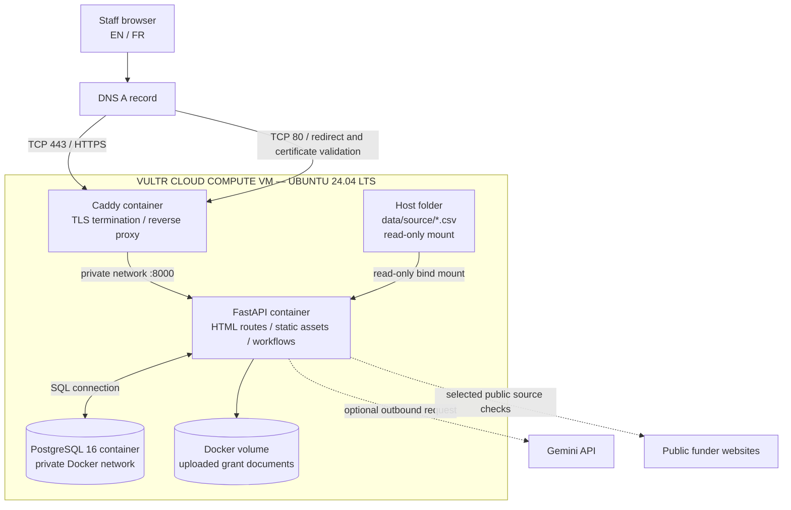

# Wai Intelligence — Vultr VM Deployment Guide

This guide deploys the current Wai Intelligence FastAPI application to a single Vultr Cloud Compute VM. It uses Docker Compose, PostgreSQL 16, and Caddy for HTTPS. The browser-facing website and backend are the same FastAPI application; there is no separate frontend hosting service.

> **Deployment model:** Vultr VM = web application + reverse proxy + private PostgreSQL service. Caddy is the only public application entry point. The source CSV folder is mounted read-only. Uploaded grant documents and PostgreSQL data use persistent Docker volumes.

## 1. Target architecture



### Services and exposure

| Component | Purpose | Publicly reachable? | Persistence |
|---|---|---:|---|
| Caddy | Public HTTPS entry point and reverse proxy | Yes, ports 80 and 443 | `caddy_data`, `caddy_config` volumes |
| FastAPI | Application routes, authentication, all five workflows | No; internal Compose network only | Application code; no local DB file |
| PostgreSQL 16 | Users, workflow records, decisions, tasks and evidence | No; private Compose network. Host loopback mapping is only for local administration/development. | `postgres_data` volume |
| Source CSV directory | Approved constituent, gift, interaction and email/video source files | No | Host directory mounted read-only |
| Upload storage | Uploaded proposals and grant documents | No | `wai_uploads` volume |

Do not add public firewall rules for TCP 5432 or 8000. The website is served by FastAPI through Caddy; there is no separate frontend deployment.

## 2. Provision the Vultr VM

1. In Vultr, create a **Cloud Compute** instance using **Ubuntu 24.04 LTS**.
2. Select the region appropriate for your operational and data-residency requirements.
3. Attach an SSH key. Avoid password-only SSH access.
4. For an initial small-team pilot, start with at least **2 vCPU and 4 GB RAM** and monitor actual memory, CPU and disk use before scaling.
5. Assign a static public IPv4 address if it is not already included in the instance plan.
6. Attach a Vultr Firewall group with the rules below.

### Required inbound firewall rules

| Protocol | Port | Source | Purpose |
|---|---:|---|---|
| TCP | 22 | Your fixed administrator IP only | SSH administration |
| TCP | 80 | `0.0.0.0/0` and `::/0` | HTTP redirect and ACME certificate validation |
| TCP | 443 | `0.0.0.0/0` and `::/0` | HTTPS website |
| UDP | 443 | `0.0.0.0/0` and `::/0` | HTTP/3 where supported by clients/Caddy |

Do **not** expose PostgreSQL (5432) or FastAPI (8000) to the internet. If using UFW as an additional host firewall, allow SSH from your own IP before enabling it; otherwise you may lock yourself out. Vultr Firewall and host firewall rules should be reviewed together.

## 3. Configure DNS

Choose the public hostname for the app, for example `wai.example.org`.

1. At the domain's DNS provider, create an **A record** pointing `wai.example.org` to the VM's public IPv4 address.
2. If you use IPv6, configure an AAAA record only after IPv6 connectivity and firewall rules are verified.
3. Wait for DNS propagation and verify from your workstation:

```bash
dig +short wai.example.org A
```

The result should be the Vultr VM's public IPv4 address. Caddy uses the `DOMAIN` value in `.env` to request and renew the HTTPS certificate. The DNS record must resolve to the VM and ports 80/443 must be reachable for automatic certificate provisioning.

## 4. Install Docker Engine and Compose on Ubuntu

SSH into the VM:

```bash
ssh deploy-user@VM_PUBLIC_IP
```

Install Docker Engine and the Compose plugin using Docker's maintained Ubuntu instructions: <https://docs.docker.com/engine/install/ubuntu/>. The following is the repository-based installation sequence for Ubuntu 24.04:

```bash
sudo apt-get update
sudo apt-get install -y ca-certificates curl
sudo install -m 0755 -d /etc/apt/keyrings
sudo curl -fsSL https://download.docker.com/linux/ubuntu/gpg \
  -o /etc/apt/keyrings/docker.asc
sudo chmod a+r /etc/apt/keyrings/docker.asc

. /etc/os-release
 echo "deb [arch=$(dpkg --print-architecture) signed-by=/etc/apt/keyrings/docker.asc] https://download.docker.com/linux/ubuntu ${VERSION_CODENAME} stable" | \
  sudo tee /etc/apt/sources.list.d/docker.list > /dev/null

sudo apt-get update
sudo apt-get install -y docker-ce docker-ce-cli containerd.io \
  docker-buildx-plugin docker-compose-plugin
sudo systemctl enable --now docker
sudo docker --version
sudo docker compose version
```

Run Docker commands with `sudo` unless you have deliberately configured a trusted deployment user. Membership in the `docker` group effectively grants root-level control of the VM.

## 5. Transfer the application to the VM

The project ZIP contains a top-level `wai-intelligence/` directory. Copy it to the VM from your workstation:

```bash
scp wai-intelligence-postgres.zip deploy-user@VM_PUBLIC_IP:/tmp/
```

On the VM:

```bash
sudo mkdir -p /opt/wai-intelligence
sudo chown "$USER":"$USER" /opt/wai-intelligence
cd /opt/wai-intelligence
unzip /tmp/wai-intelligence-postgres.zip
cd /opt/wai-intelligence/wai-intelligence
```

Alternatively, clone a **private** Git repository into `/opt/wai-intelligence/wai-intelligence`. Do not place real constituent/donor data in a public repository or in the application image.

## 6. Install the complete source datasets

The app reads approved CSV files directly from `data/source/`. The directory is mounted read-only inside the FastAPI container. It does not import these source rows into PostgreSQL.

The expected filenames are:

- `constituent_profile_table.csv`
- `gift_transactions_table.csv`
- `CRM_interacions_table.csv` — preserve this spelling used in the supplied specification.
- `video_email_data_table.csv`

The files currently included in the demonstration package are sample rows only. Copy the full approved datasets from your secure workstation or storage location. For example, run this from your workstation (replace the local source path if necessary):

```bash
scp /path/to/approved/source/*.csv \
  deploy-user@VM_PUBLIC_IP:/opt/wai-intelligence/wai-intelligence/data/source/
```

On the VM, assign read access to the container's non-root UID (10001):

```bash
cd /opt/wai-intelligence/wai-intelligence
sudo chown -R 10001:10001 data/source
sudo chmod 750 data/source
sudo find data/source -maxdepth 1 -type f -name '*.csv' -exec chmod 640 {} \;
```

This gives the application read access but the Compose mount itself is also explicitly read-only (`:ro`). Keep production datasets out of Git and restrict host access to this directory. If the source data is stored elsewhere, update the **host-side** path in the `app` service volume entry in `docker-compose.yml`; keep the container-side path `/app/data/source:ro` unless `WAI_DATA_DIR` is changed too.

## 7. Configure production environment variables

Create the environment file and generate unique secrets:

```bash
cd /opt/wai-intelligence/wai-intelligence
cp .env.example .env
openssl rand -hex 32
openssl rand -hex 24
```

Edit `.env`:

```dotenv
ENVIRONMENT=production
SECRET_KEY=<output-of-first-openssl-command>
POSTGRES_PASSWORD=<output-of-second-openssl-command>
DOMAIN=wai.example.org
SESSION_HTTPS_ONLY=true
DEMO_SEED_USERS=false
GOOGLE_API_KEY=<optional-Gemini-API-key>
GEMINI_MODEL=gemini-3.5-flash
```

Keep the other settings unless you have a specific reason to change them. `docker-compose.yml` overrides `DATABASE_URL` for the FastAPI container to use the private PostgreSQL service name `db`. Use the hexadecimal database password generated above so it is safe to interpolate into the Compose connection string.

Lock down the secrets file:

```bash
chmod 600 .env
```

**Production account warning:** `DEMO_SEED_USERS=false` disables the two demo login accounts. It does not remove all demonstration workflow records. On a new empty database, the current application seeds demonstration funding opportunities, fictional donor profiles and sample reporting/due-diligence records. Review and replace/remove those demonstration records before operational use with WaterAid data. Create real accounts only after the application is running, as shown in Step 10.

## 8. Validate and start the web deployment

Check the rendered Compose configuration. Do not paste the output into public tickets because it may contain interpolated secrets:

```bash
sudo docker compose config --quiet
```

Build and start the services:

```bash
sudo docker compose up -d --build
sudo docker compose ps
sudo docker compose logs --tail=100 db app caddy
```

Expected service roles:

- `db` starts PostgreSQL and stores its data in `postgres_data`.
- `app` starts FastAPI on container port 8000; that port is not published publicly.
- `caddy` publishes ports 80/443 and reverse-proxies the domain to `app:8000`.

Caddy stores certificate state in `caddy_data` and configuration state in `caddy_config`. Do not delete these volumes during an ordinary application update.

## 9. Verify the deployment

From the VM:

```bash
sudo docker compose ps
sudo docker compose logs --tail=100 app caddy db
```

From your workstation:

```bash
curl -fsS https://wai.example.org/healthz
```

The health check should return `ok`. Then open `https://wai.example.org/` and verify:

1. The landing page loads over HTTPS.
2. Sign-in is required before any workspace route can be used.
3. English and Canadian French can be selected.
4. The dashboard detects the four source files in the read-only source folder.
5. CSV exports work for an authenticated user.
6. The admin account can access administration and the ordinary user cannot.
7. The LLM-backed functions report their configured/unconfigured state correctly.

Do not use the demo credentials on a public deployment.

## 10. Create production user accounts

The application does not seed demo logins when `DEMO_SEED_USERS=false`. Create the administrator and staff account interactively. The script prompts for and confirms a password of at least 14 characters; passwords are not passed on the command line.

```bash
sudo docker compose exec app python -m app.scripts.create_user \
  --username wai-admin --role admin --display-name "Wai Administrator"

sudo docker compose exec app python -m app.scripts.create_user \
  --username fundraising-lead --role user --display-name "Fundraising Lead"
```

Use unique passwords. The administrator can subsequently manage staff access from the admin dashboard.

## 11. Backups and restore planning

A PostgreSQL backup does **not** include source CSVs, uploaded grant documents, Caddy certificates or `.env`. Back up each of these separately and store backups off the VM in a protected location.

Create a PostgreSQL logical backup:

```bash
cd /opt/wai-intelligence/wai-intelligence
sudo mkdir -p backups
sudo chmod 700 backups
sudo docker compose exec -T db pg_dump -U wai_app -d wai_intelligence \
  > "backups/wai-$(date +%F-%H%M).sql"
```

Also back up:

- `data/source/` — approved read-only source datasets.
- Docker volume `wai_uploads` — uploaded proposal and grant documents.
- `.env` — store securely; never commit it to Git.
- `postgres_data` — preferably rely on tested PostgreSQL logical backups rather than copying a live database volume as ordinary files.

Test restoration into a separate staging instance before relying on backups. Decide and document retention, encryption, access permissions and recovery objectives with the organization's data owner.

## 12. Deploy a future application update

1. Take and verify a PostgreSQL backup and back up uploaded documents/source datasets.
2. Transfer the reviewed release or pull the approved private Git revision.
3. Run `sudo docker compose config --quiet`.
4. Rebuild and restart:

```bash
sudo docker compose up -d --build
sudo docker compose ps
sudo docker compose logs --tail=150 app caddy db
```

5. Repeat the health, sign-in, source-data, language, role and CSV-export checks from Step 9.

The current application calls SQLAlchemy `create_all` at startup. That creates missing tables but is **not** a database migration mechanism and does not safely apply arbitrary schema changes to an existing database. For future model/schema changes, introduce and review a migration (for example, Alembic), test it against a staging copy and backup, and only then apply it to production.

## 13. Troubleshooting

| Symptom | Checks |
|---|---|
| Caddy cannot obtain a certificate | Confirm the A record resolves to the VM; confirm ports 80/443 reach the VM; verify `DOMAIN` exactly matches the hostname; inspect `sudo docker compose logs caddy`. |
| FastAPI cannot connect to PostgreSQL | Check `sudo docker compose ps db`; inspect DB health/logs; confirm `.env` has `POSTGRES_PASSWORD`; review the app container's `DATABASE_URL` override in Compose. |
| Source files are missing | Confirm all four exact filenames exist under `data/source/`; check directory/file permissions for UID 10001; confirm the Compose mount and `WAI_DATA_DIR`. |
| Browser shows 502 | Check `sudo docker compose logs app`; verify the app container is healthy and listening on port 8000 internally. |
| HTTPS works but sign-in/session fails | Confirm `SESSION_HTTPS_ONLY=true`, `ENVIRONMENT=production`, a stable `SECRET_KEY`, and the correct public hostname. |
| Disk usage grows | Check Docker logs, uploaded document volume, PostgreSQL size and backups; establish rotation and retention rather than deleting active volumes. |

## Official deployment references

- Vultr Cloud Compute provisioning: <https://docs.vultr.com/products/compute/instances/cloud-compute/provisioning>
- Vultr Firewall quickstart: <https://docs.vultr.com/firewall-quickstart-for-vultr-cloud-servers>
- Vultr DNS provisioning: <https://docs.vultr.com/products/network/dns/provisioning>
- Vultr DNS record management: <https://docs.vultr.com/products/network/dns/management/manage-records>
- Docker Engine installation on Ubuntu: <https://docs.docker.com/engine/install/ubuntu/>
- Docker Compose installation: <https://docs.docker.com/compose/install/linux/>
